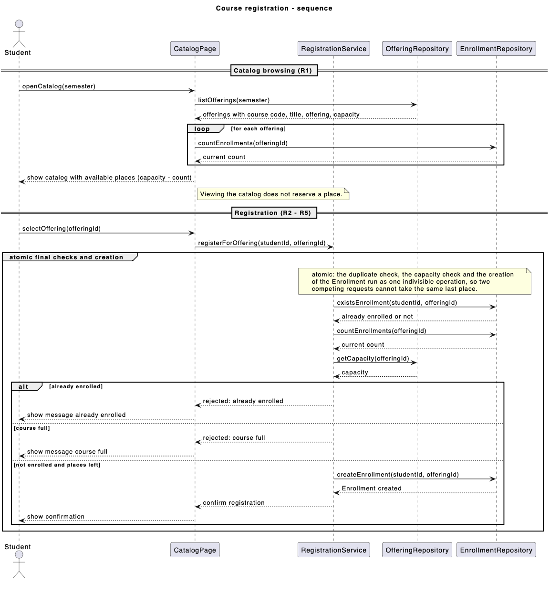
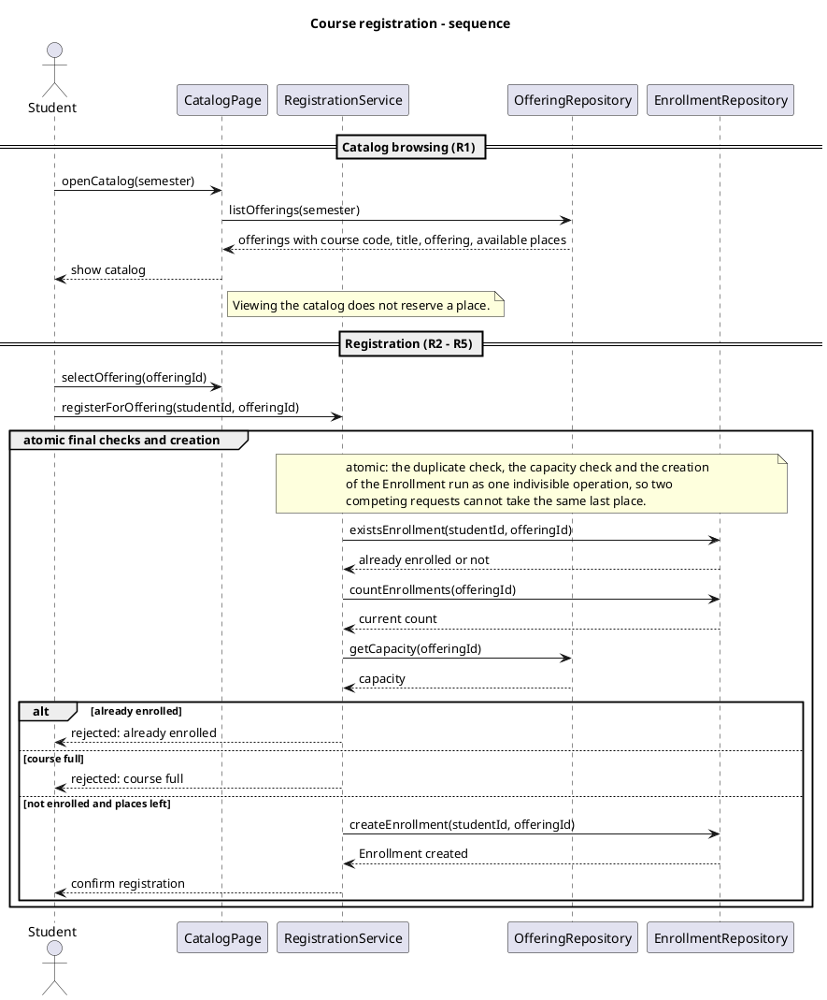
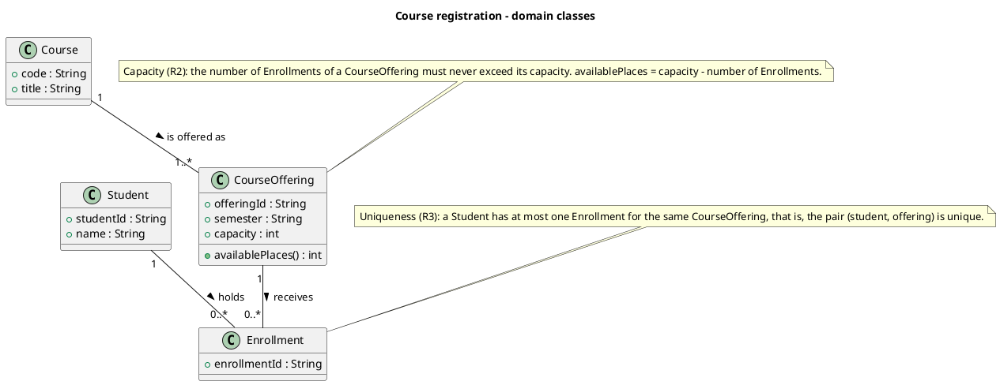
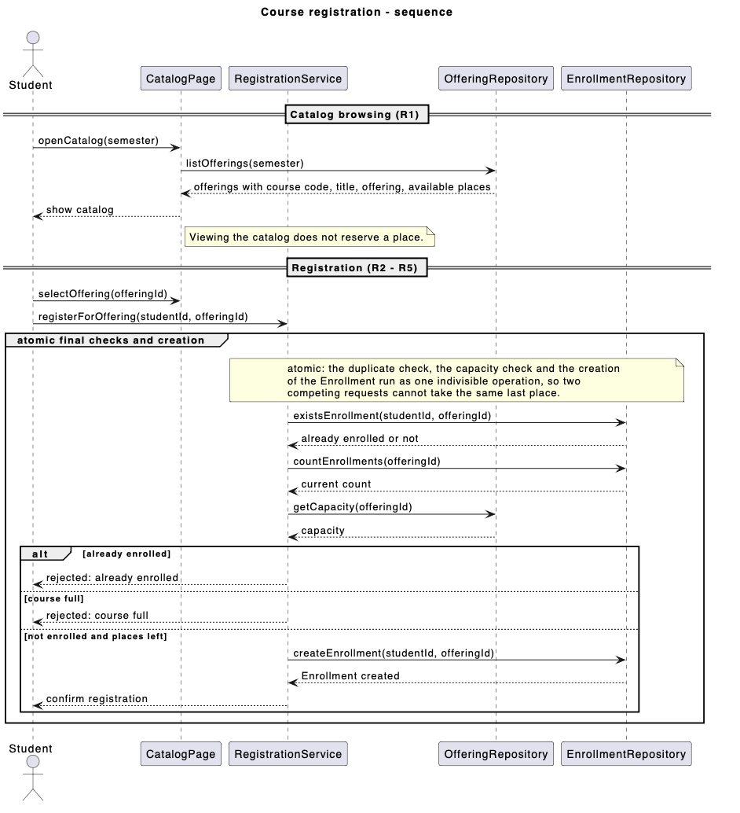
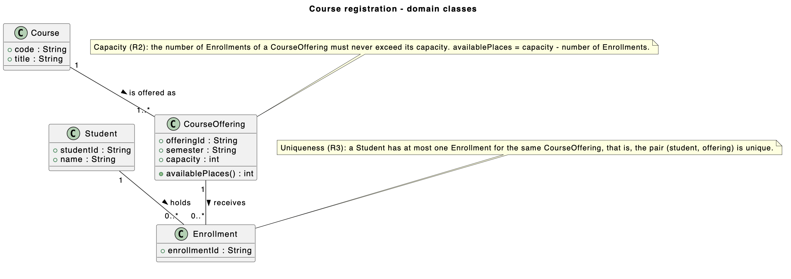

# SIS #02 — AI-Assisted UML Modeling: University Course Registration

## 1. Scope and assumptions

**Scope:** The system allows signed-in students to browse course offerings for one semester and register for a selected offering while respecting capacity and duplicate-enrollment rules. Rejected requests explain the reason and change no state. Payments, prerequisites, timetable clashes, waiting lists, and cancellation are out of scope.

**Assumptions:**

1. Each CourseOffering belongs to one Course and represents a specific scheduled section in one semester.
2. Available places equal the offering's capacity minus its current enrollment count, and browsing the catalog does not reserve a place.
3. The catalog view may be outdated, so availability is rechecked when the student requests registration.

## 2. User stories and acceptance criteria

### US-01 — Browse offerings

**US-01:** As a student, I want to browse course offerings for one semester, so that I can see the course details and available places before choosing an offering.

- **AC-01** (R1): Given a semester with several course offerings, When the student opens the course catalog, Then each offering displays the course code, course title, offering details, and number of available places.
- **AC-02** (R1): Given a course offering with a capacity of 3 and 1 existing enrollment, When the student views the catalog, Then the catalog displays 2 available places and does not reserve a place for the student.

### US-02 — Register for an offering

**US-02:** As a student, I want to register for a specific course offering, so that I can obtain a place in that section.

- **AC-03** (R2, R4): Given a course offering with at least one available place at the time of registration and a student who is not already enrolled in that offering, When the student requests registration, Then exactly one Enrollment linking the student and the offering is created, the number of available places decreases by one, and a confirmation is returned.
- **AC-04** (R2, R4): Given a course offering with exactly one available place and a student who is not already enrolled in it, When the student requests registration, Then the registration succeeds, the enrollment count becomes equal to the offering's capacity, and the number of available places becomes zero.

### US-03 — Receive a clear rejection

**US-03:** As a student, I want to receive a clear explanation when my registration is rejected, so that I understand why the request failed.

- **AC-05** (R2, R5): Given that the catalog previously showed an available place but the offering is full when the registration request is processed, When the student requests registration, Then the request is rejected with the message "course full", no Enrollment is created, and the enrollment count remains unchanged.
- **AC-06** (R3, R5): Given a student who is already enrolled in a course offering, When the same student requests registration for that offering again, Then the request is rejected with the message "already enrolled", no additional Enrollment is created, and the enrollment count remains unchanged.

## 3. Sequence diagram

<!-- The FINAL diagram, rendered. Change .png to .svg if that is what you exported. -->



**Participants:** (write here — each lifeline and what it stands for)

**Atomic operation:** (write here — which messages form the one atomic step: the final duplicate check, the capacity check and the creation of the Enrollment, and why a catalog view reserves nothing)

**Where the Enrollment is created:** (write here — which message, which lifeline, and which class in section 4 it produces)

**Technical lifelines:** (write here — every lifeline that is NOT a class in the class diagram, by name, and why the difference in abstraction is fine. "None" if there are none.)

## 4. Class diagram

<!-- The FINAL diagram, rendered. -->


<!-- One row per association in classes.puml, read in both directions. -->

| Association | Read left to right | Read right to left |
| --- | --- | --- |
| (write here) | (write here) | (write here) |
| (write here) | (write here) | (write here) |
| (write here) | (write here) | (write here) |

**How an Enrollment links a student to an offering:** (write here)

**Capacity constraint:** (write here — and why multiplicity alone cannot express it)

**Uniqueness constraint:** (write here — and why multiplicity alone cannot express it)

## 5. Traceability

<!-- Every rule, including the catalog fields and availability (R1). Column 1: the rule and
     the criteria that cover it, e.g. "R2 + AC-03, AC-04". Column 2: the message, guard,
     class or constraint that shows the rule in YOUR diagrams. Column 3: the T-ID that
     exercises it, or the extra check you did instead (R1 has no T case). -->

| Rule and criterion | Model evidence | Validation case |
| --- | --- | --- |
| R1 + (write here) | (write here) | (write here) |
| R2 + (write here) | (write here) | (write here) |
| R3 + (write here) | (write here) | (write here) |
| R4 + (write here) | (write here) | (write here) |
| R5 + (write here) | (write here) | (write here) |

## 6. Walkthroughs

<!-- Walk each case through YOUR final sequence diagram, message by message. Column 2: the
     actual steps and the state change (count before → after). Column 3 starts with Pass or
     Fail, then the location: the message, guard or note where you saw it. A Fail you
     report honestly is a finding, not a penalty. -->

| Case | Observed path and state change | Judgment and evidence |
| --- | --- | --- |
| T1. Available | (write here) | (write here) |
| T2. Last place | (write here) | (write here) |
| T3. Full | (write here) | (write here) |
| T4. Duplicate | (write here) | (write here) |

## 7. Review decisions

<!-- At least three substantive decisions about Prompt C's critique or your own inspection.
     Decision: accepted / rejected / modified — and what you did. Reason: why, in a full
     sentence. Rule: R1–R5. Do not invent an error to fill the table; a justified rejection
     of advice counts. -->

| AI suggestion or model element | Decision | Reason | Rule |
| --- | --- | --- | --- |
| (write here) | (write here) | (write here) | (write here) |
| (write here) | (write here) | (write here) | (write here) |
| (write here) | (write here) | (write here) | (write here) |

## 8. Modeling explanation

<!-- 200–300 words. Your main design choices; how the class diagram and the sequence diagram
     complement each other; why an activity diagram could also help explain the workflow. -->

(write here)

## 9. Reflection

<!-- 150–200 words. Written by you, not by the assistant: where AI helped, one decision you
     made yourself, one remaining limitation. Specific beats flattering. -->

(write here)

## 10. Appendix A — Before AI

**Scope:** The system allows signed-in students to browse course offerings for one semester and register for a selected offering while respecting capacity and duplicate-enrollment rules.

**Initial assumptions:**

1. Each CourseOffering belongs to one Course and represents a specific scheduled section in one semester.
2. Available places equal the offering's capacity minus its current enrollment count, and browsing the catalog does not reserve a place.

## 11. Appendix B — AI exchanges

<!-- Complete prompts and complete responses, as text — never screenshots. Paste each inside
     the ~~~~ block that follows its label: AI responses contain ``` PlantUML blocks, and
     ~~~~ keeps them from breaking this file. Prompts B and C: the prompt text first, then
     the material it refers to ("below", "these two") pasted under it, in the same block.
     You may add B5, B6 … after B4 if you ran more. -->

### B1 — Requirements (Prompt A)

- **Tool:** ChatGPT
- **Model:** GPT 6
- **Date:** 2026-10-18
- **Purpose:** draft 3 user stories and 6 acceptance criteria

**Prompt:**

~~~~text
Act as a requirements analyst. Use only this course registration scenario and rules R1–R5: A student browses an electronic course catalog, chooses a course offering and requests registration. Each offering has a limited number of places. A Course describes a subject. A CourseOffering is one scheduled section in one semester. Registration always targets a specific offering. Assume that the student is signed in, the selected offering exists, and its capacity is a positive whole number. Exclude payments, prerequisites, timetable clashes, waiting lists and cancellation. Use fictional students and courses. R1. Catalog: Show the course code, title, offering and available places for one semester. R2. Capacity: Recheck current availability when registering. Enrollment must never exceed the offering's capacity. R3. Duplicates: A student may have at most one enrollment in the same offering. Reject a repeat request. R4. Success: Create exactly one Enrollment linking the student and offering, update availability and return a confirmation. R5. Rejection: Explain "course full" or "already enrolled". Create no enrollment and leave the enrollment count unchanged. A catalog view does not reserve a place. Model the final checks and enrollment creation as one atomic operation so competing requests cannot take the same last place. A note describing the atomic operation is sufficient; database implementation is outside this assignment. My initial assumptions are 1. Each CourseOffering belongs to one Course and represents a specific scheduled section in one semester. 2. Available places equal the offering's capacity minus its current enrollment count, and browsing the catalog does not reserve a place.
Draft 3 user stories and 2 Given / When / Then acceptance criteria for each. Use IDs US-01 to US-03 and AC-01 to AC-06. Map each criterion to rule IDs.
Cover normal and rejection behavior. List uncertainty separately. Do not add excluded features or invent university policies.
~~~~

**Response:**

~~~~text
## User stories and acceptance criteria

### US-01 — Browse offerings
**US-01:** As a student, I want to browse the catalog of course offerings for one semester, so that I can see the course code, title, offering and available places before choosing.

- **AC-01** (R1): Given a semester with several course offerings, When the student opens the catalog, Then each row shows the course code, course title, offering and the number of available places.
- **AC-02** (R1): Given an offering with capacity 3 and 1 enrollment, When the student views the catalog, Then it shows 2 available places and no place is reserved for the student.

### US-02 — Register for an offering
**US-02:** As a student, I want to register for a specific course offering, so that I get a place in that section.

- **AC-03** (R2, R4): Given an offering with at least one place left at the moment of registration and a student with no enrollment in it, When the student requests registration, Then exactly one Enrollment linking the student and the offering is created, the available places decrease by one and a confirmation is returned.
- **AC-04** (R2, R4): Given an offering with exactly one place left, When a student with no enrollment in it registers, Then the registration succeeds, the enrollment count equals the capacity and no places remain.

### US-03 — Receive a clear rejection
**US-03:** As a student, I want a clear explanation when registration is refused, so that I understand why and the system stays consistent.

- **AC-05** (R2, R5): Given the catalog showed a place but the current enrollment count equals the capacity when the student registers, When the student requests registration, Then the request is rejected with "course full", no Enrollment is created and the enrollment count is unchanged.
- **AC-06** (R3, R5): Given a student who already has an enrollment in the offering, When the same student requests registration again, Then the request is rejected with "already enrolled", no Enrollment is created and the enrollment count is unchanged.

## Rule coverage
- R1: AC-01, AC-02
- R2: AC-03, AC-04, AC-05
- R3: AC-06
- R4: AC-03, AC-04
- R5: AC-05, AC-06

## Uncertainty (listed separately)
- The scenario does not say how the confirmation is shown (message, screen, or both); I assume only that a confirmation is returned.
- It is not stated whether the catalog refreshes automatically; I assume the displayed places can be stale, so availability is rechecked at registration.
- It is not stated which check comes first when a student is both already enrolled and the offering is full; the rules do not define the priority.
- The format of "semester" (for example "Fall 2026") is not specified.
~~~~

### B2 — UML drafts (Prompt B)

- **Tool:** ChatGPT
- **Model:** GPT 6
- **Date:** 2026-10-18
- **Purpose:** draft the sequence and class diagrams

**Prompt:**

~~~~text
Using my approved scenario, R1–R5, stories and criteria below, return separate PlantUML code blocks for a sequence diagram and a domain class diagram.
Sequence: include catalog browsing and guarded success, full-course and duplicate outcomes. Model final checks and creation as one atomic operation.
Class: show domain concepts, useful attributes and multiplicities. State the capacity and uniqueness constraints. Explain assumptions and any technical lifelines.

### US-01 — Browse offerings

**US-01:** As a student, I want to browse course offerings for one semester, so that I can see the course details and available places before choosing an offering.

- **AC-01** (R1): Given a semester with several course offerings, When the student opens the course catalog, Then each offering displays the course code, course title, offering details, and number of available places.
- **AC-02** (R1): Given a course offering with a capacity of 3 and 1 existing enrollment, When the student views the catalog, Then the catalog displays 2 available places and does not reserve a place for the student.

### US-02 — Register for an offering

**US-02:** As a student, I want to register for a specific course offering, so that I can obtain a place in that section.

- **AC-03** (R2, R4): Given a course offering with at least one available place at the time of registration and a student who is not already enrolled in that offering, When the student requests registration, Then exactly one Enrollment linking the student and the offering is created, the number of available places decreases by one, and a confirmation is returned.
- **AC-04** (R2, R4): Given a course offering with exactly one available place and a student who is not already enrolled in it, When the student requests registration, Then the registration succeeds, the enrollment count becomes equal to the offering's capacity, and the number of available places becomes zero.

### US-03 — Receive a clear rejection

**US-03:** As a student, I want to receive a clear explanation when my registration is rejected, so that I understand why the request failed.

- **AC-05** (R2, R5): Given that the catalog previously showed an available place but the offering is full when the registration request is processed, When the student requests registration, Then the request is rejected with the message "course full", no Enrollment is created, and the enrollment count remains unchanged.
- **AC-06** (R3, R5): Given a student who is already enrolled in a course offering, When the same student requests registration for that offering again, Then the request is rejected with the message "already enrolled", no additional Enrollment is created, and the enrollment count remains unchanged.
~~~~

**Response:**

~~~~text
## Sequence diagram



## Class diagram



## Assumptions
- Capacity is a positive whole number, the student is signed in and the selected offering exists (given by the scenario).
- availablePlaces is derived: capacity minus the number of Enrollments of that offering. It is not stored separately.
- A CourseOffering belongs to exactly one Course and one semester.
- When a student is both already enrolled and the offering is full, the duplicate check is evaluated first.

## Technical lifelines
CatalogPage, RegistrationService, OfferingRepository and EnrollmentRepository are technical lifelines. They are not domain classes and do not appear in the class diagram. They show who does the work: CatalogPage presents data, RegistrationService runs the registration logic, and the two repositories read and create the domain objects Course, CourseOffering and Enrollment. The class diagram stays at the domain level, and the sequence diagram adds the technical level.
~~~~

### B3 — Model critique (Prompt C)

- **Tool:** (write here)
- **Model:** (write here)
- **Date:** (write here)
- **Purpose:** review both models against R1–R5 and T1–T4

**Prompt:**

~~~~text
(paste here)
~~~~

**Response:**

~~~~text
(paste here)
~~~~

### B4 — Focused revision (Prompt D)

- **Tool:** (write here)
- **Model:** (write here)
- **Date:** (write here)
- **Purpose:** apply my accepted review decisions

**Prompt:**

~~~~text
(paste here)
~~~~

**Response:**

~~~~text
(paste here)
~~~~

## 12. Appendix C — Original diagrams

<!-- The AI's first output from Prompt B, rendered unedited from models/original/. -->





## 13. Appendix D — References and source checks

### References

<!-- Full references, one per line, each starting with "- ". Only sources you actually opened.
     Every URL used in the source checks must also appear here. Example:
     - Sommerville, I. (2016). Software Engineering, 10th ed., Global Edition. Pearson. Ch. 5. -->

- (write here)

### Source checks

<!-- At least two modeling decisions you verified. Source and locator: title + slide, page,
     section, chapter or figure — or title + URL + access date (YYYY-MM-DD). Slide numbers
     refer to the decks posted in our Teams. -->

| Modeling decision | Source and locator | What the source says | How it supports or changed your model |
| --- | --- | --- | --- |
| (write here) | (write here) | (write here) | (write here) |
| (write here) | (write here) | (write here) | (write here) |
