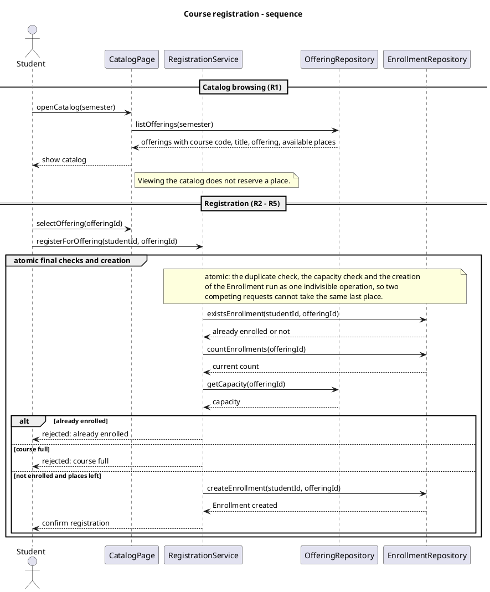
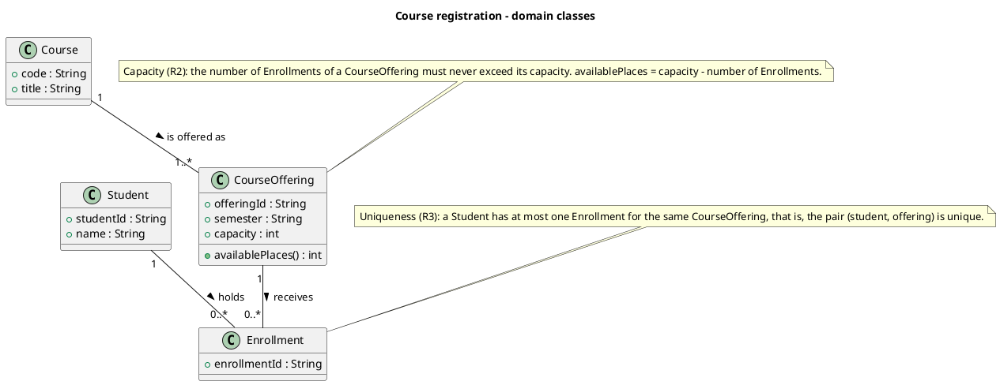
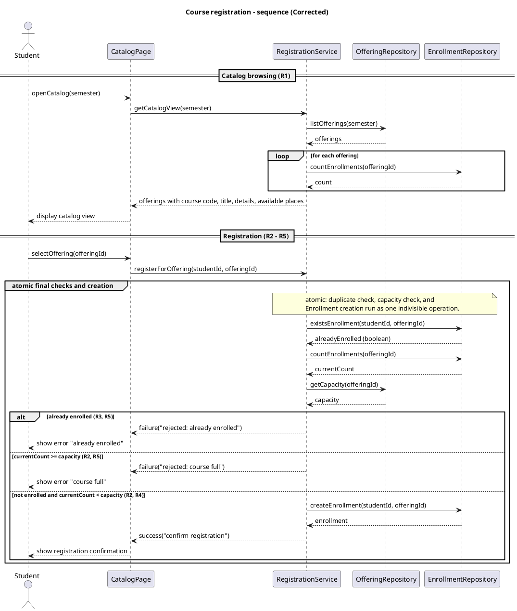
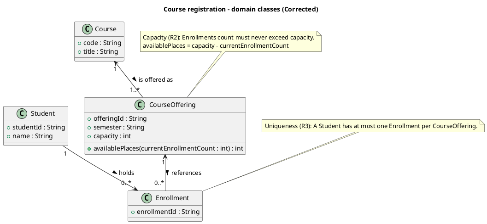
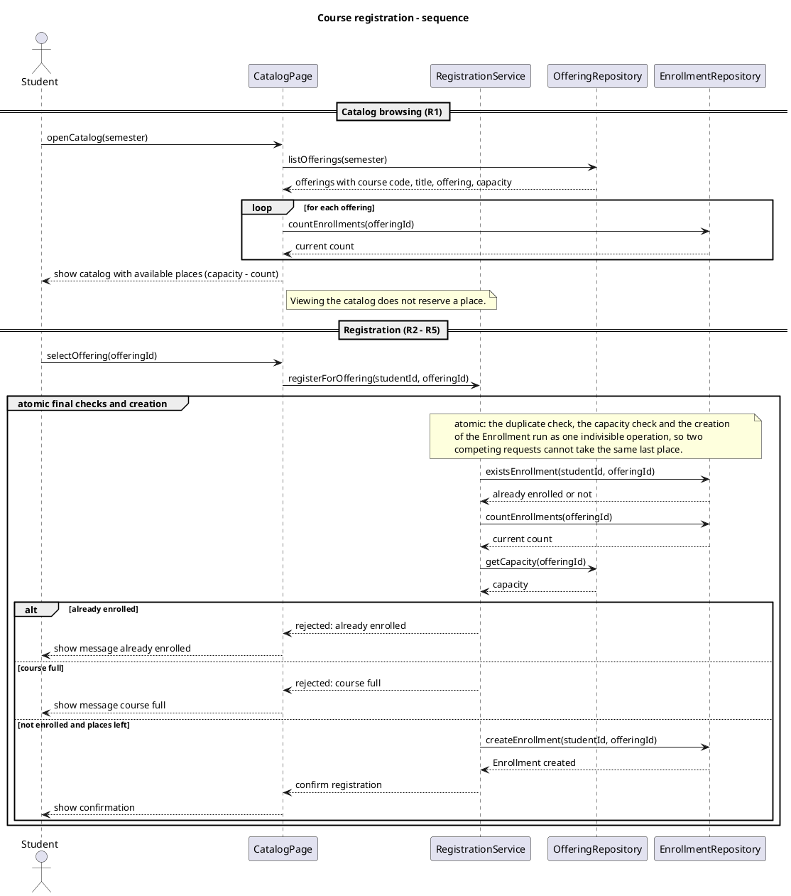

# SIS #02 — AI-Assisted UML Modeling: University Course Registration

## 1. Scope and assumptions

**Scope:** The system allows signed-in students to browse course offerings for one semester and register for a selected offering while respecting capacity and duplicate-enrollment rules. Rejected requests explain the reason and change no state. Payments, prerequisites, timetable clashes, waiting lists, and cancellation are out of scope.

**Assumptions:**

1. Each CourseOffering belongs to one Course and represents a specific scheduled section in one semester.
2. Available places equal the offering's capacity minus its current enrollment count, and browsing the catalog does not reserve a place.
3. The catalog view may be outdated, so availability is rechecked when the student requests registration.

## 2. User stories and acceptance criteria

### US-01 — Browse offerings

**US-01:** As a student, I want to browse course offerings for one semester, so that I can see the course details and available places before choosing an offering.

- **AC-01** (R1): Given a semester with several course offerings, When the student opens the course catalog, Then each offering displays the course code, course title, offering details, and number of available places.
- **AC-02** (R1): Given a course offering with a capacity of 3 and 1 existing enrollment, When the student views the catalog, Then the catalog displays 2 available places and does not reserve a place for the student.

### US-02 — Register for an offering

**US-02:** As a student, I want to register for a specific course offering, so that I can obtain a place in that section.

- **AC-03** (R2, R4): Given a course offering with at least one available place at the time of registration and a student who is not already enrolled in that offering, When the student requests registration, Then exactly one Enrollment linking the student and the offering is created, the number of available places decreases by one, and a confirmation is returned.
- **AC-04** (R2, R4): Given a course offering with exactly one available place and a student who is not already enrolled in it, When the student requests registration, Then the registration succeeds, the enrollment count becomes equal to the offering's capacity, and the number of available places becomes zero.

### US-03 — Receive a clear rejection

**US-03:** As a student, I want to receive a clear explanation when my registration is rejected, so that I understand why the request failed.

- **AC-05** (R2, R5): Given that the catalog previously showed an available place but the offering is full when the registration request is processed, When the student requests registration, Then the request is rejected with the message "course full", no Enrollment is created, and the enrollment count remains unchanged.
- **AC-06** (R3, R5): Given a student who is already enrolled in a course offering, When the same student requests registration for that offering again, Then the request is rejected with the message "already enrolled", no additional Enrollment is created, and the enrollment count remains unchanged.

## 3. Sequence diagram

**Participants:** Student is the actor who uses the catalog. CatalogPage is the screen that shows the catalog and the result messages. RegistrationService runs the registration logic and the final checks. OfferingRepository reads offerings (course code, title, semester, capacity). EnrollmentRepository checks duplicates, counts Enrollments and creates the Enrollment.

**Atomic operation:** The messages existsEnrollment, countEnrollments, getCapacity, the alt choice and createEnrollment are inside the group "atomic final checks and creation". They run as one operation, so two requests cannot both take the last place. A catalog view reserves nothing because browsing only reads data (listOfferings, countEnrollments), so its count can be old. This is why the checks are repeated at registration.

**Where the Enrollment is created:** In the message createEnrollment(studentId, offeringId), sent by RegistrationService to EnrollmentRepository in the branch "else not enrolled and places left". It produces an Enrollment object, the class Enrollment in section 4.

**Technical lifelines:** CatalogPage, RegistrationService, OfferingRepository and EnrollmentRepository are not classes in the class diagram. The difference in abstraction is fine: the class diagram shows the domain (what things are), and the sequence diagram shows who does the work. The repositories read and create Course, CourseOffering and Enrollment objects.

## 4. Class diagram

| Association | Read left to right | Read right to left |
| --- | --- | --- |
| Student "1" -- "0..*" Enrollment : holds > | One Student holds zero or more Enrollments. | Each Enrollment is held by exactly one Student. |
| CourseOffering "1" -- "0..*" Enrollment : receives > | One CourseOffering receives zero or more Enrollments. | Each Enrollment belongs to exactly one CourseOffering. |
| Course "1" -- "1..*" CourseOffering : is offered as > | One Course is offered as one or more CourseOfferings. | Each CourseOffering belongs to exactly one Course. |

**How an Enrollment links a student to an offering:** Each Enrollment has exactly one Student and exactly one CourseOffering (multiplicity 1 on both sides). So one Enrollment is one registration of one student in one offering.

**Capacity constraint:** Note N1: the number of Enrollments of a CourseOffering must never exceed its capacity. Multiplicity 0..* has no upper limit, and it cannot use the capacity value, which is different for each offering.

**Uniqueness constraint:** Note N2: a Student has at most one Enrollment for the same CourseOffering. Multiplicities describe each end separately, so they cannot say that the pair (student, offering) may appear only once.
## 5. Traceability

| Rule and criterion | Model evidence | Validation case |
| --- | --- | --- |
| R1 + AC-01, AC-02 | listOfferings, countEnrollments loop, "show catalog with available places (capacity - count)"; note "does not reserve a place"; Course code/title, CourseOffering semester/capacity | No T case. Extra check: capacity 3 and 1 enrollment gives 3 - 1 = 2 places (AC-02) |
| R2 + AC-03, AC-04, AC-05 | countEnrollments and getCapacity before the alt; branch "else course full"; group atomic note; note N1 | T2, T3 |
| R3 + AC-06 | existsEnrollment; branch "alt already enrolled"; note N2 | T4 |
| R4 + AC-03, AC-04 | createEnrollment, then "confirm registration" in the success branch; Enrollment links Student and CourseOffering | T1, T2 |
| R5 + AC-05, AC-06 | branches "already enrolled" and "course full" return a rejection and have no createEnrollment or confirm | T3, T4 |

## 6. Walkthroughs

| Case | Observed path and state change | Judgment and evidence |
| --- | --- | --- |
| T1. Available | Catalog shows 2 places. selectOffering, then registerForOffering. existsEnrollment: not enrolled. countEnrollments: 0. getCapacity: 2. The third branch runs: createEnrollment, "Enrollment created", confirm registration, show confirmation. Count changes from 0 to 1. | Pass. Branch "else not enrolled and places left"; confirm comes after createEnrollment. |
| T2. Last place | Same messages. countEnrollments returns 1, capacity 2, not enrolled. The third branch runs and creates one Enrollment. Count changes from 1 to 2, so no places remain. | Pass. Branch "else not enrolled and places left", message createEnrollment. |
| T3. Full | The catalog was old. At registration existsEnrollment: not enrolled, countEnrollments: 2, capacity: 2. Branch "else course full" returns "rejected: course full" to CatalogPage, which shows the message. No createEnrollment, no confirm. Count stays 2. | Pass. Branch "else course full"; no creating message inside it. |
| T4. Duplicate | Same student requests again. existsEnrollment returns already enrolled. Branch "alt already enrolled" returns "rejected: already enrolled" and CatalogPage shows it. No createEnrollment, no confirm. Count stays 1. | Pass. Branch "alt already enrolled". Note: countEnrollments and getCapacity still run before the alt, but they only read data. |

## 7. Review decisions

| AI suggestion or model element | Decision | Reason | Rule |
| --- | --- | --- | --- |
| Original: registerForOffering goes from Student directly to RegistrationService and results return to Student | Accepted: CatalogPage calls RegistrationService and the result returns via CatalogPage | The page that shows the catalog should also show the result, so the student sees one clear path. | R4, R5 |
| Original: listOfferings returns "available places" from OfferingRepository | Accepted: repository returns capacity, CatalogPage gets countEnrollments and shows capacity - count | The offering repository does not know the enrollments, so it cannot give available places alone. | R1 |
| Prompt C: CourseOffering has no association to Enrollment, so change availablePlaces(enrollmentCount) | Rejected: class diagram unchanged | The diagram already has CourseOffering "1" -- "0..*" Enrollment : receives >, so the critique was wrong. | R1 |
| Prompt C: add navigability arrows to the associations | Rejected | Plain associations with multiplicities at both ends can be read in both directions, as section 4 requires. | R4 |
| Prompt C: merge checks into one enroll() call | Rejected | The group atomic already exists, and separate messages show the checks before the creation. | R2 |
| Prompt D flag: R4 says "update availability" but there is no update message | Kept as it is | Availability is derived as capacity - count, so createEnrollment already changes it. | R4 |

## 8. Modeling explanation

The course registration system is modeled using a sequence diagram and a domain class diagram. Each diagram describes a different aspect of the system. The class diagram shows the main domain concepts: Student, Course, CourseOffering, and Enrollment. Student represents the person registering for an offering. Course describes the subject, while CourseOffering represents a scheduled section in a semester. Enrollment connects one student to one specific offering.

The class diagram also documents two important constraints. First, the number of Enrollments associated with a CourseOffering must not exceed its capacity. Second, the combination of student and offering must be unique. These constraints are expressed through notes because multiplicities alone cannot enforce the numeric capacity limit or uniqueness of a particular student-offering pair.

The sequence diagram describes how the system behaves when a student browses the catalog and requests registration. During catalog browsing, the system obtains offering capacities and enrollment counts to calculate available places. Viewing the catalog does not reserve a place. When registration is requested, the system checks for an existing enrollment and rechecks current capacity. It creates an Enrollment only if the student is not already enrolled and a place remains. The result is returned through CatalogPage, which displays a confirmation or a clear rejection message.

The atomic-operation note describes the requirement that final checks and creation must be indivisible, preventing competing requests from exceeding capacity. In a real implementation, this would require suitable transaction or concurrency-control mechanisms.

An activity diagram could complement these models by presenting the overall workflow, including decision points for duplicate enrollment, course capacity, successful registration, and rejection. The sequence diagram emphasizes message order, while the class diagram explains the domain structure and relationships.

## 9. Reflection

AI helped me during the initial requirements analysis by suggesting user stories, acceptance criteria, and draft UML diagrams. One useful contribution was identifying the need to calculate available places from capacity and the current enrollment count.

However, I learned that AI-generated diagrams still require careful review. For example, I identified that the original sequence diagram sent registration requests and results directly between Student and RegistrationService, bypassing CatalogPage. I decided to correct this interaction so that the interface handles the result returned by the service.

I also evaluated suggestions that I did not consider necessary for the agreed model. In particular, I retained the existing domain associations and did not introduce a DTO because these changes were not required to represent the specified domain rules.

One remaining limitation is that an atomic-operation note describes the intended behavior but does not prove that a real implementation prevents concurrent registrations from exceeding capacity. Another limitation is that the UML models do not provide executable evidence of correctness.

Through this task, I learned that UML modeling involves more than drawing classes and messages. Each element must be justified by requirements, acceptance criteria, and the intended responsibilities of the system.

## 10. Appendix A — Before AI

**Scope:** The system allows signed-in students to browse course offerings for one semester and register for a selected offering while respecting capacity and duplicate-enrollment rules.

**Initial assumptions:**

1. Each CourseOffering belongs to one Course and represents a specific scheduled section in one semester.
2. Available places equal the offering's capacity minus its current enrollment count, and browsing the catalog does not reserve a place.

## 11. Appendix B — AI exchanges

### B1 — Requirements (Prompt A)

- **Tool:** ChatGPT
- **Model:** GPT 6
- **Date:** 2026-10-18
- **Purpose:** draft 3 user stories and 6 acceptance criteria

**Prompt:**

~~~~text
Act as a requirements analyst. Use only this course registration scenario and rules R1–R5: A student browses an electronic course catalog, chooses a course offering and requests registration. Each offering has a limited number of places. A Course describes a subject. A CourseOffering is one scheduled section in one semester. Registration always targets a specific offering. Assume that the student is signed in, the selected offering exists, and its capacity is a positive whole number. Exclude payments, prerequisites, timetable clashes, waiting lists and cancellation. Use fictional students and courses. R1. Catalog: Show the course code, title, offering and available places for one semester. R2. Capacity: Recheck current availability when registering. Enrollment must never exceed the offering's capacity. R3. Duplicates: A student may have at most one enrollment in the same offering. Reject a repeat request. R4. Success: Create exactly one Enrollment linking the student and offering, update availability and return a confirmation. R5. Rejection: Explain "course full" or "already enrolled". Create no enrollment and leave the enrollment count unchanged. A catalog view does not reserve a place. Model the final checks and enrollment creation as one atomic operation so competing requests cannot take the same last place. A note describing the atomic operation is sufficient; database implementation is outside this assignment. My initial assumptions are 1. Each CourseOffering belongs to one Course and represents a specific scheduled section in one semester. 2. Available places equal the offering's capacity minus its current enrollment count, and browsing the catalog does not reserve a place.
Draft 3 user stories and 2 Given / When / Then acceptance criteria for each. Use IDs US-01 to US-03 and AC-01 to AC-06. Map each criterion to rule IDs.
Cover normal and rejection behavior. List uncertainty separately. Do not add excluded features or invent university policies.
~~~~

**Response:**

~~~~text
## User stories and acceptance criteria

### US-01 — Browse offerings
**US-01:** As a student, I want to browse the catalog of course offerings for one semester, so that I can see the course code, title, offering and available places before choosing.

- **AC-01** (R1): Given a semester with several course offerings, When the student opens the catalog, Then each row shows the course code, course title, offering and the number of available places.
- **AC-02** (R1): Given an offering with capacity 3 and 1 enrollment, When the student views the catalog, Then it shows 2 available places and no place is reserved for the student.

### US-02 — Register for an offering
**US-02:** As a student, I want to register for a specific course offering, so that I get a place in that section.

- **AC-03** (R2, R4): Given an offering with at least one place left at the moment of registration and a student with no enrollment in it, When the student requests registration, Then exactly one Enrollment linking the student and the offering is created, the available places decrease by one and a confirmation is returned.
- **AC-04** (R2, R4): Given an offering with exactly one place left, When a student with no enrollment in it registers, Then the registration succeeds, the enrollment count equals the capacity and no places remain.

### US-03 — Receive a clear rejection
**US-03:** As a student, I want a clear explanation when registration is refused, so that I understand why and the system stays consistent.

- **AC-05** (R2, R5): Given the catalog showed a place but the current enrollment count equals the capacity when the student registers, When the student requests registration, Then the request is rejected with "course full", no Enrollment is created and the enrollment count is unchanged.
- **AC-06** (R3, R5): Given a student who already has an enrollment in the offering, When the same student requests registration again, Then the request is rejected with "already enrolled", no Enrollment is created and the enrollment count is unchanged.

## Rule coverage
- R1: AC-01, AC-02
- R2: AC-03, AC-04, AC-05
- R3: AC-06
- R4: AC-03, AC-04
- R5: AC-05, AC-06

## Uncertainty (listed separately)
- The scenario does not say how the confirmation is shown (message, screen, or both); I assume only that a confirmation is returned.
- It is not stated whether the catalog refreshes automatically; I assume the displayed places can be stale, so availability is rechecked at registration.
- It is not stated which check comes first when a student is both already enrolled and the offering is full; the rules do not define the priority.
- The format of "semester" (for example "Fall 2026") is not specified.
~~~~

### B2 — UML drafts (Prompt B)

- **Tool:** ChatGPT
- **Model:** GPT 6
- **Date:** 2026-10-18
- **Purpose:** draft the sequence and class diagrams

**Prompt:**

~~~~text
Using my approved scenario, R1–R5, stories and criteria below, return separate PlantUML code blocks for a sequence diagram and a domain class diagram.
Sequence: include catalog browsing and guarded success, full-course and duplicate outcomes. Model final checks and creation as one atomic operation.
Class: show domain concepts, useful attributes and multiplicities. State the capacity and uniqueness constraints. Explain assumptions and any technical lifelines.

### US-01 — Browse offerings

**US-01:** As a student, I want to browse course offerings for one semester, so that I can see the course details and available places before choosing an offering.

- **AC-01** (R1): Given a semester with several course offerings, When the student opens the course catalog, Then each offering displays the course code, course title, offering details, and number of available places.
- **AC-02** (R1): Given a course offering with a capacity of 3 and 1 existing enrollment, When the student views the catalog, Then the catalog displays 2 available places and does not reserve a place for the student.

### US-02 — Register for an offering

**US-02:** As a student, I want to register for a specific course offering, so that I can obtain a place in that section.

- **AC-03** (R2, R4): Given a course offering with at least one available place at the time of registration and a student who is not already enrolled in that offering, When the student requests registration, Then exactly one Enrollment linking the student and the offering is created, the number of available places decreases by one, and a confirmation is returned.
- **AC-04** (R2, R4): Given a course offering with exactly one available place and a student who is not already enrolled in it, When the student requests registration, Then the registration succeeds, the enrollment count becomes equal to the offering's capacity, and the number of available places becomes zero.

### US-03 — Receive a clear rejection

**US-03:** As a student, I want to receive a clear explanation when my registration is rejected, so that I understand why the request failed.

- **AC-05** (R2, R5): Given that the catalog previously showed an available place but the offering is full when the registration request is processed, When the student requests registration, Then the request is rejected with the message "course full", no Enrollment is created, and the enrollment count remains unchanged.
- **AC-06** (R3, R5): Given a student who is already enrolled in a course offering, When the same student requests registration for that offering again, Then the request is rejected with the message "already enrolled", no additional Enrollment is created, and the enrollment count remains unchanged.
~~~~

**Response:**

~~~~text
## Sequence diagram

## Class diagram

## Assumptions
- Capacity is a positive whole number, the student is signed in and the selected offering exists (given by the scenario).
- availablePlaces is derived: capacity minus the number of Enrollments of that offering. It is not stored separately.
- A CourseOffering belongs to exactly one Course and one semester.
- When a student is both already enrolled and the offering is full, the duplicate check is evaluated first.

## Technical lifelines
CatalogPage, RegistrationService, OfferingRepository and EnrollmentRepository are technical lifelines. They are not domain classes and do not appear in the class diagram. They show who does the work: CatalogPage presents data, RegistrationService runs the registration logic, and the two repositories read and create the domain objects Course, CourseOffering and Enrollment. The class diagram stays at the domain level, and the sequence diagram adds the technical level.
~~~~

### B3 — Model critique (Prompt C)

- **Tool:** ChatGPT
- **Model:** GPT 6
- **Date:** 2026-10-18
- **Purpose:** review both models against R1–R5 and T1–T4

**Prompt:**

~~~~text
Review these two UML models against R1–R5 and my acceptance criteria. Check message order, guards, state changes, multiplicities and naming.
Inspect the four validation cases: available places, exactly one place, full course after a stale catalog view, and duplicate registration.
For each issue, cite the affected rule and model element. Explain the impact and propose a focused correction. Separate genuine defects from optional design choices.

Sequence diagram:

Class diagram:

Rules:
R1. Catalog: Show the course code, title, offering and available places for one semester.
R2. Capacity: Recheck current availability when registering. Enrollment must never exceed the offering's capacity.
R3. Duplicates: A student may have at most one enrollment in the same offering. Reject a repeat request.
R4. Success: Create exactly one Enrollment linking the student and offering, update availability and return a confirmation.
R5. Rejection: Explain "course full" or "already enrolled". Create no enrollment and leave the enrollment count unchanged.

Acceptance criteria:
- AC-01 (R1): Given a semester with several course offerings, When the student opens the course catalog, Then each offering displays the course code, course title, offering details, and number of available places.
- AC-02 (R1): Given a course offering with a capacity of 3 and 1 existing enrollment, When the student views the catalog, Then the catalog displays 2 available places and does not reserve a place for the student.
- AC-03 (R2, R4): Given a course offering with at least one available place at the time of registration and a student who is not already enrolled in that offering, When the student requests registration, Then exactly one Enrollment linking the student and the offering is created, the number of available places decreases by one, and a confirmation is returned.
- AC-04 (R2, R4): Given a course offering with exactly one available place and a student who is not already enrolled in it, When the student requests registration, Then the registration succeeds, the enrollment count becomes equal to the offering's capacity, and the number of available places becomes zero.
- AC-05 (R2, R5): Given that the catalog previously showed an available place but the offering is full when the registration request is processed, When the student requests registration, Then the request is rejected with the message "course full", no Enrollment is created, and the enrollment count remains unchanged.
- AC-06 (R3, R5): Given a student who is already enrolled in a course offering, When the same student requests registration for that offering again, Then the request is rejected with the message "already enrolled", no additional Enrollment is created, and the enrollment count remains unchanged.
~~~~

**Response:**

~~~~text
Here is a comprehensive review of the sequence diagram and class diagram against rules **R1–R5**, acceptance criteria **AC-01–AC-06**, and the four validation scenarios.

---

## 1. Summary of Deficiencies & Validation Case Analysis

### Validation Cases

1. **Available Places (AC-01, AC-02, AC-03):**
* **Defect:** In the sequence diagram, `OfferingRepository.listOfferings()` returns `available places` directly, but `OfferingRepository` only knows `capacity`. To compute `availablePlaces = capacity - count(Enrollments)` (as defined in `N1`), `OfferingRepository` needs to interact with or query `EnrollmentRepository`.

2. **Exactly One Place (AC-04):**
* **Pass/Minor Defect:** The atomic registration sequence handles the count check correctly (`capacity - current count = 1 > 0`), but the return signal to the actor passes through `CatalogPage` ambiguity (see Issue #1).

3. **Full Course after Stale Catalog View (AC-05):**
* **Pass:** Handled correctly by the atomic guard check at execution time (`course full` alt branch). Stale view read during browsing does not affect registration outcome.

4. **Duplicate Registration (AC-06):**
* **Pass:** Handled correctly by the atomic guard check `existsEnrollment` (`already enrolled` alt branch).

---

## 2. Genuine Defects (Rule & Acceptance Criteria Violations)

### Issue 1: Asynchronous / Misdirected Response & Message Order

* **Affected Rules / AC:** R4, R5, AC-03, AC-05, AC-06
* **Affected Diagram:** Sequence Diagram
* **Element:** `Student -> CatalogPage : selectOffering(offeringId)`, `Student -> RegistrationService : registerForOffering(...)`
* **Description & Impact:**
In the sequence diagram, `Student` sends `selectOffering` to `CatalogPage` and then directly calls `RegistrationService.registerForOffering(...)`. The responses (`confirm registration`, `rejected:...`) are returned from `RegistrationService` directly to `Student`.
1. This violates standard layered architecture where UI/Frontend (`CatalogPage`) orchestrates user actions and handles view transitions.
2. If `CatalogPage` handles `selectOffering`, it should delegate to `RegistrationService`, and `RegistrationService` should return to `CatalogPage`, which displays the confirmation/rejection to the `Student`.

* **Proposed Correction:**
Reroute the calls through `CatalogPage`:
`Student -> CatalogPage : selectOffering(offeringId)`
`CatalogPage -> RegistrationService : registerForOffering(studentId, offeringId)`
`RegistrationService --> CatalogPage : result`
`CatalogPage --> Student : show confirmation / rejection message`

---

### Issue 2: Incorrect Domain Responsibility for Catalog & Available Places Calculation

* **Affected Rules / AC:** R1, AC-01, AC-02
* **Affected Diagram:** Sequence Diagram & Class Diagram
* **Element:** `OfferingRepository.listOfferings(semester)`, `CourseOffering.availablePlaces()`
* **Description & Impact:**
* In the sequence diagram, `OfferingRepository.listOfferings(...)` returns `available places`. However, as shown in the Class Diagram (Note `N1`), `availablePlaces = capacity - number of Enrollments`. `OfferingRepository` alone cannot determine enrollment counts without joining/querying `EnrollmentRepository`.
* In the Class Diagram, `CourseOffering` has a method `availablePlaces() : int`, but `CourseOffering` does not have an association to `Enrollment` (the association is `CourseOffering "1" -- "0..*" Enrollment`). Therefore, an instance of `CourseOffering` cannot calculate its own `availablePlaces()` in isolation without being supplied the enrollment count or referencing enrollments.

* **Proposed Correction:**
1. In the sequence diagram during Catalog Browsing, show `RegistrationService` or `CatalogPage` coordinating between `OfferingRepository` and `EnrollmentRepository` (or show `OfferingRepository` querying enrollment counts internally).
2. In the class diagram, either add a navigable association from `CourseOffering` to `Enrollment` (`CourseOffering "1" -> "0..*" Enrollment`) or pass `enrollmentCount` into `availablePlaces(enrollmentCount: int)`.

---

### Issue 3: Missing Navigability and Bi-directional Association Discrepancies

* **Affected Rules / AC:** R4, AC-03
* **Affected Diagram:** Class Diagram
* **Element:** Associations between `Student`, `CourseOffering`, and `Enrollment`
* **Description & Impact:**
The class diagram defines associations with direction labels (`holds >`, `receives >`), but lacks explicit navigability arrows (`->`). Without specified navigability or direct associations:
* Traversing from `Student` to their `CourseOffering`s or checking if a `Student` is enrolled in a specific `CourseOffering` relies on navigating through intermediate `Enrollment` entities without clear directional responsibilities.

* **Proposed Correction:**
Explicitly mark navigability arrows (e.g., `Student "1" --> "0..*" Enrollment` and `CourseOffering "1" <-- "0..*" Enrollment`) or introduce a direct link/method if required by domain queries.

---

## 3. Optional Design Choices & Improvements

1. **Stateful vs. Stateless Domain Operations:**
* *Observation:* In the Sequence Diagram, state queries (`existsEnrollment`, `countEnrollments`, `getCapacity`) are issued individually before creation.
* *Improvement:* To reinforce R2/R3 atomicity in real implementation, this logic is often encapsulated inside a single transactional method call (e.g., `EnrollmentService.enroll(studentId, offeringId)`), which performs the check-and-insert in one database transaction using pessimistic/optimistic locking.

2. **Naming Consistency:**
* *Observation:* The return message `offerings with course code, title, offering, available places` uses informal wording.
* *Improvement:* Replace with concrete return types or DTOs, e.g., `List<OfferingDTO>`.

---

## 4. Corrected UML Diagrams

### Corrected Sequence Diagram (PlantUML)

### Corrected Class Diagram (PlantUML)

~~~~

### B4 — Focused revision (Prompt D)

- **Tool:** ChatGPT
- **Model:** GPT 6
- **Date:** 2026-10-18
- **Purpose:** apply my accepted review decisions

**Prompt:**

~~~~text
Revise the UML sources using only my accepted review decisions: 1. Accept: route registration through CatalogPage (CatalogPage calls RegistrationService, result returns RegistrationService → CatalogPage → Student). 2. Accept: in catalog browsing, obtain enrollment counts from EnrollmentRepository so available places are computed; do not change the class diagram. 3. Reject: keep plain associations with multiplicities at both ends, no navigability arrows. 4. Reject: the atomic group and the separate duplicate, capacity and create messages already exist; no change. 5. Reject: no DTO. Keep the guards exactly as alt already enrolled / else course full / else not enrolled and places left, without extra conditions or square brackets.. Keep justified existing elements and explain each change.
Preserve the agreed scope and rule IDs. Return both updated PlantUML blocks and a concise change log. Flag any unresolved issue.
Approved requirements: ### US-01 — Browse offerings

**US-01:** As a student, I want to browse course offerings for one semester, so that I can see the course details and available places before choosing an offering.

- **AC-01** (R1): Given a semester with several course offerings, When the student opens the course catalog, Then each offering displays the course code, course title, offering details, and number of available places.
- **AC-02** (R1): Given a course offering with a capacity of 3 and 1 existing enrollment, When the student views the catalog, Then the catalog displays 2 available places and does not reserve a place for the student.

### US-02 — Register for an offering

**US-02:** As a student, I want to register for a specific course offering, so that I can obtain a place in that section.

- **AC-03** (R2, R4): Given a course offering with at least one available place at the time of registration and a student who is not already enrolled in that offering, When the student requests registration, Then exactly one Enrollment linking the student and the offering is created, the number of available places decreases by one, and a confirmation is returned.
- **AC-04** (R2, R4): Given a course offering with exactly one available place and a student who is not already enrolled in it, When the student requests registration, Then the registration succeeds, the enrollment count becomes equal to the offering's capacity, and the number of available places becomes zero.

### US-03 — Receive a clear rejection

**US-03:** As a student, I want to receive a clear explanation when my registration is rejected, so that I understand why the request failed.

- **AC-05** (R2, R5): Given that the catalog previously showed an available place but the offering is full when the registration request is processed, When the student requests registration, Then the request is rejected with the message "course full", no Enrollment is created, and the enrollment count remains unchanged.
- **AC-06** (R3, R5): Given a student who is already enrolled in a course offering, When the same student requests registration for that offering again, Then the request is rejected with the message "already enrolled", no additional Enrollment is created, and the enrollment count remains unchanged.

Original sources:

models/original/sequence.puml:

@startuml
title Course registration - sequence

actor Student
participant CatalogPage
participant RegistrationService
participant OfferingRepository
participant EnrollmentRepository

== Catalog browsing (R1) ==
Student -> CatalogPage : openCatalog(semester)
CatalogPage -> OfferingRepository : listOfferings(semester)
OfferingRepository --> CatalogPage : offerings with course code, title, offering, available places
CatalogPage --> Student : show catalog
note right of CatalogPage
  Viewing the catalog does not reserve a place.
end note

== Registration (R2 - R5) ==
Student -> CatalogPage : selectOffering(offeringId)
Student -> RegistrationService : registerForOffering(studentId, offeringId)

group atomic final checks and creation
  note over RegistrationService, EnrollmentRepository
    atomic: the duplicate check, the capacity check and the creation
    of the Enrollment run as one indivisible operation, so two
    competing requests cannot take the same last place.
  end note

  RegistrationService -> EnrollmentRepository : existsEnrollment(studentId, offeringId)
  EnrollmentRepository --> RegistrationService : already enrolled or not
  RegistrationService -> EnrollmentRepository : countEnrollments(offeringId)
  EnrollmentRepository --> RegistrationService : current count
  RegistrationService -> OfferingRepository : getCapacity(offeringId)
  OfferingRepository --> RegistrationService : capacity

  alt already enrolled
    RegistrationService --> Student : rejected: already enrolled
  else course full
    RegistrationService --> Student : rejected: course full
  else not enrolled and places left
    RegistrationService -> EnrollmentRepository : createEnrollment(studentId, offeringId)
    EnrollmentRepository --> RegistrationService : Enrollment created
    RegistrationService --> Student : confirm registration
  end
end
@enduml

models/original/classes.puml:

@startuml
title Course registration - domain classes

class Student {
  +studentId : String
  +name : String
}

class Course {
  +code : String
  +title : String
}

class CourseOffering {
  +offeringId : String
  +semester : String
  +capacity : int
  +availablePlaces() : int
}

class Enrollment {
  +enrollmentId : String
}

Student "1" -- "0..*" Enrollment : holds >
CourseOffering "1" -- "0..*" Enrollment : receives >
Course "1" -- "1..*" CourseOffering : is offered as >

note "Capacity (R2): the number of Enrollments of a CourseOffering must never exceed its capacity. availablePlaces = capacity - number of Enrollments." as N1
N1 .. CourseOffering

note "Uniqueness (R3): a Student has at most one Enrollment for the same CourseOffering, that is, the pair (student, offering) is unique." as N2
N2 .. Enrollment
@enduml

My review decisions and evidence:
- Issue 1 (response routing): accepted. Evidence: in the original sequence, selectOffering goes to CatalogPage and does nothing, while registerForOffering and all results go directly between Student and RegistrationService. R4, R5.
- Issue 2, catalog part: accepted. Evidence: OfferingRepository only knows capacity, so listOfferings cannot return available places without enrollment counts from EnrollmentRepository. R1.
- Issue 2, class part: rejected. Evidence: classes.puml already has CourseOffering "1" -- "0..*" Enrollment : receives >, so availablePlaces() is derivable from that association and note N1. R1.
- Issue 3 (navigability): rejected. Evidence: plain associations with multiplicities at both ends can be read in both directions, as the report requires. R4.
- Optional atomic transaction: rejected, already modeled. Evidence: group atomic and a note containing the word atomic exist, and the duplicate check, capacity check and createEnrollment are separate messages in the original. R2.
- Optional OfferingDTO: rejected. Evidence: a DTO is an implementation detail
~~~~

**Response:**

~~~~text
## Updated sequence diagram

## Updated class diagram

## Change log
1. Decision 1 (accepted): selectOffering now leads to CatalogPage -> RegistrationService : registerForOffering. All results return RegistrationService -> CatalogPage -> Student. The rejection branches still return only "already enrolled" / "course full" and contain no create, save, update or confirm message. The confirmation is still sent after createEnrollment, in the success branch only.
2. Decision 2 (accepted, catalog part): OfferingRepository now returns capacity instead of available places. CatalogPage asks EnrollmentRepository for countEnrollments for each offering and shows capacity minus count. The class diagram is unchanged.
3. Decision 3 (rejected): associations keep plain "--" with multiplicities at both ends. No change.
4. Decision 4 (rejected): the atomic group, its note and the separate existsEnrollment, countEnrollments, getCapacity and createEnrollment messages are kept as they were.
5. Decision 5 (rejected): no DTO added.
6. Guards are exactly: alt already enrolled / else course full / else not enrolled and places left.
7. Class diagram: no changes, per decisions 2 and 3.

## Unresolved issues
- R4 says "update availability". In this model availability is derived (capacity minus number of Enrollments) and not stored, so no separate update message exists. Creating the Enrollment changes the derived value. Confirm that this is acceptable.
- The registration part of the sequence diagram shows the atomic group as a note only. Locking or transaction mechanics are outside this assignment's scope.
~~~~

## 12. Appendix C — Original diagrams

## 13. Appendix D — References and source checks

### References

- Object Management Group (OMG). Unified Modeling Language (UML), Version 2.5.1. https://www.omg.org/spec/UML. Accessed 2026-10-18.
- PlantUML. Class Diagram — Official Documentation. https://plantuml.com/class-diagram. Accessed 2026-10-18.

### Source checks

| Modeling decision | Source and locator | What the source says | How it supports or changed your model |
| --- | --- | --- | --- |
| Represent domain classes and their relationships. | PlantUML, Class Diagram documentation, section "Class diagram" and "Relations between classes", https://plantuml.com/class-diagram, accessed 2026-10-18. | A class diagram describes classes, attributes, methods, and relationships. PlantUML supports relationship notation, labels, and multiplicities. | Supports using Student, Course, CourseOffering, and Enrollment as domain classes and documenting their associations and multiplicities. |
| Represent associations and multiplicities clearly. | PlantUML, Class Diagram documentation, section "Label on relations", https://plantuml.com/class-diagram, accessed 2026-10-18. | Relationship labels can be added, and cardinalities can be represented using quoted values at the ends of a relationship. | Supports the multiplicities in the class diagram. The capacity and uniqueness rules remain explicit constraints because the diagram's multiplicities alone do not express those business rules. |